# Pattern library — evive-base

Generic patterns every customer can use. They contain neutral placeholder text (translatable, text domain `evive`) and placeholder art shipped in `assets/images/`, use tokens only, and make no external requests. Customer-specific patterns live in the child theme.

**Live gallery:** https://whyatwork.cloud/pattern-gallery/ (staging; shown with the active theme, so with a child theme active it shows the customer's brand).

Screenshots per pattern: **default palette** (desktop), **dark-primary test palette** (desktop) and **mobile** (390px, default palette). The dark-primary palette is the test palette from `tools/` / card D.1: deep green primary with an orange accent.

## Building blocks used by the patterns
- **Card** block style for Group (`is-style-card`): `base` background, `border` hairline, radius `l`, shadow `s`.
- **Motif** block style for Group (`is-style-motif`): two large, faded rounded-rectangle outlines in the text colour behind the section. Used by *Hero: on primary colour*.
- **Shadow tokens** `s`, `m`, `l` (added in 0.3.0, as proposed in D.1). They are built from the `contrast` colour with `color-mix()`, so they follow the palette.
- **Page without title** template (`page-no-title`) for pages that start with a hero (the hero has the H1).
- **Moving strip** block style for Group (`is-style-logo-strip`) and **Carousel** block style for Columns (`is-style-carousel`): see *Logo wall* and *Testimonials: grid of three* below (evive #413).
- **FAQ structured data:** a Group with class `evive-faq` outputs `FAQPage` JSON-LD built from its Details blocks (summary = question, content = answer). Editors only edit the visible text.

## Block: Tabs
`evive/tabs` with inner `evive/tab` blocks · block category Design · theme block in `blocks/tabs/` (evive #411)

Content in tabs (for example desks / rooms / parking): one tab is shown at a time and each tab holds any blocks. Inserting the block gives three tabs; add more with the + below the last tab, and type each tab's label above its content. In the editor all tabs are shown one below the other.

- **Accessible:** WAI-ARIA tabs pattern: `role="tablist"`, `tab` and `tabpanel`, linked with `aria-controls` / `aria-labelledby`. Mouse, touch and keyboard: Tab moves to the selected tab, Left/Right arrows (wrapping), Home and End switch tabs; Tab again moves into the open panel. A link to an anchor inside a panel opens that tab.
- **Without JavaScript** the tab list stays hidden and every tab is shown with its label as a heading (H3), as in the last screenshot.
- **Loading:** its script (`view.js`, about 2.5 KB, not minified) and CSS load only on pages that contain the block.
- **Tokens:** labels `muted`, the selected tab `contrast` with a `primary` underline, the line below the list `border`.
- **Saved markup:** both blocks save only their inner blocks (labels in the block comment); the tab list is rendered in PHP, so later front-end changes don't make saved content invalid.

| Default | Dark primary (tab "Rooms" selected) | Mobile |
|---|---|---|
| 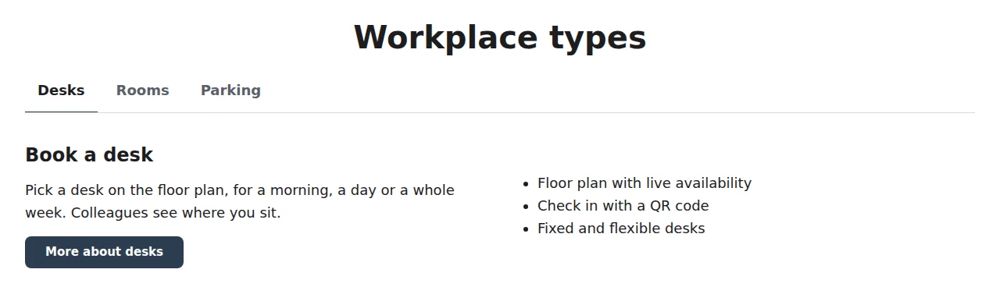 | 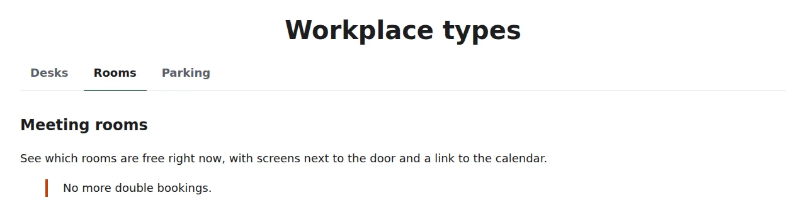 | 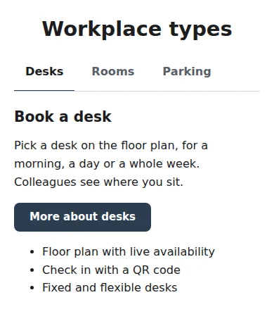 |

Without JavaScript:

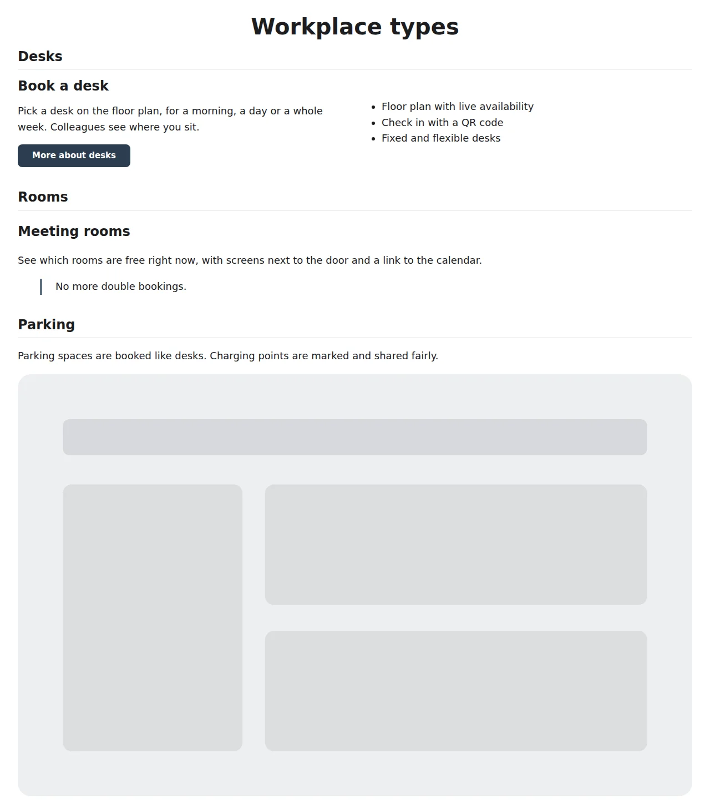

## Hero: text and image
`evive/hero-media` · category `evive-hero`

Page heading, intro text and two buttons, with an image or screenshot on the side.

| Default | Dark primary | Mobile |
|---|---|---|
| 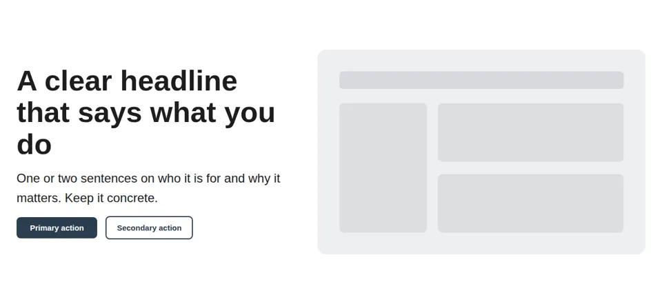 |  | 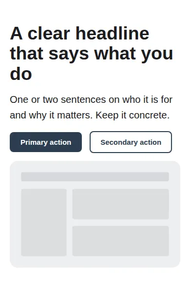 |

## Hero: split 50/50
`evive/hero-split` · category `evive-hero`

Two equal halves: text on a surface background, image on the other side.

| Default | Dark primary | Mobile |
|---|---|---|
| 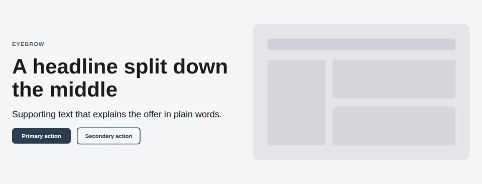 |  |  |

## Hero: page title and intro
`evive/hero-page` · category `evive-hero`

Simple page hero: heading and an intro paragraph, for inner pages.

| Default | Dark primary | Mobile |
|---|---|---|
|  |  |  |

## Hero: on primary colour
`evive/hero-primary` · category `evive-hero`

Hero on the primary colour. Uses the Motif block style (faded rounded rectangles); switch the style to Default to remove it.

| Default | Dark primary | Mobile |
|---|---|---|
|  |  | 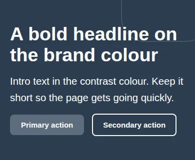 |

## Features: three cards
`evive/features-cards` · category `evive-features`

Section heading and three feature cards with an icon, text and a link.

| Default | Dark primary | Mobile |
|---|---|---|
| 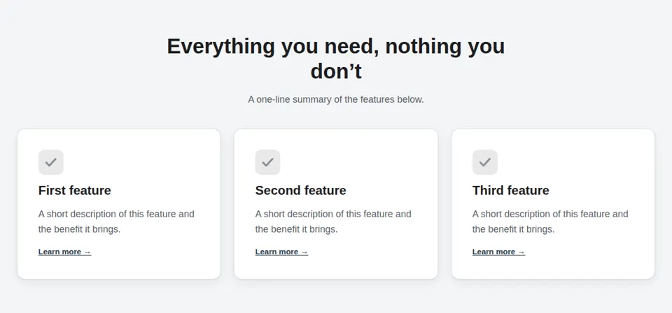 | 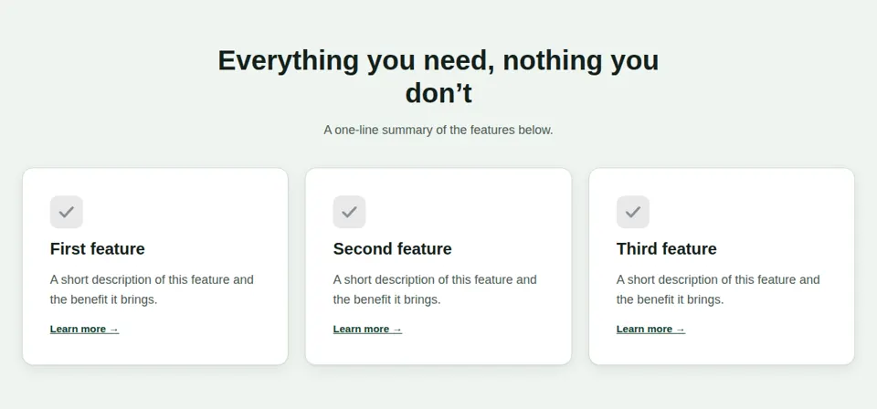 | 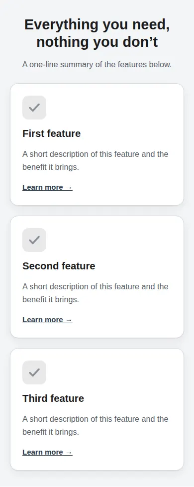 |

## Features: alternating image and text
`evive/features-alternating` · category `evive-features`

Rows of text and image that swap sides, one per feature.

| Default | Dark primary | Mobile |
|---|---|---|
|  |  |  |

## Features: icon list
`evive/features-icon-list` · category `evive-features`

Heading on the left, a two-column list of short points with icons on the right.

| Default | Dark primary | Mobile |
|---|---|---|
| 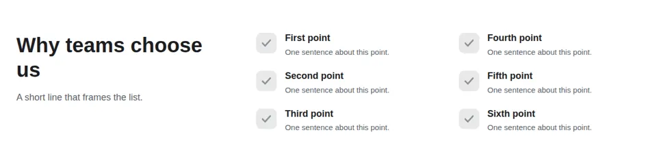 |  |  |

## CTA band: primary colour
`evive/cta-primary` · category `evive-cta`

Call-to-action band on the primary colour with one button.

| Default | Dark primary | Mobile |
|---|---|---|
|  | 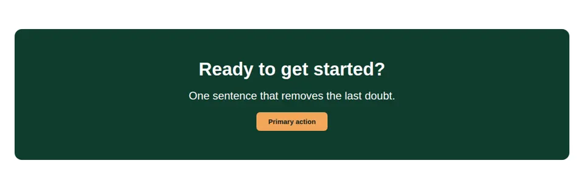 | 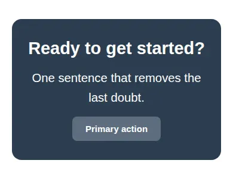 |

## CTA band: surface
`evive/cta-surface` · category `evive-cta`

Call-to-action band on the surface colour with one button.

| Default | Dark primary | Mobile |
|---|---|---|
| 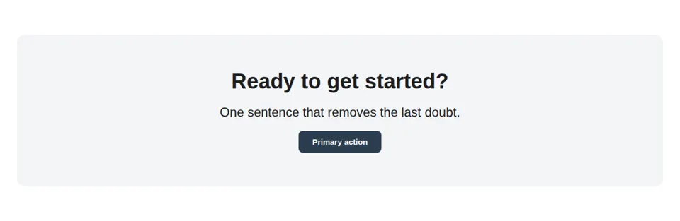 |  |  |

## FAQ
`evive/faq` · category `evive-content`

Frequently asked questions as expandable Details blocks. Adds FAQPage structured data (JSON-LD) built from the questions and answers.

| Default | Dark primary | Mobile |
|---|---|---|
| 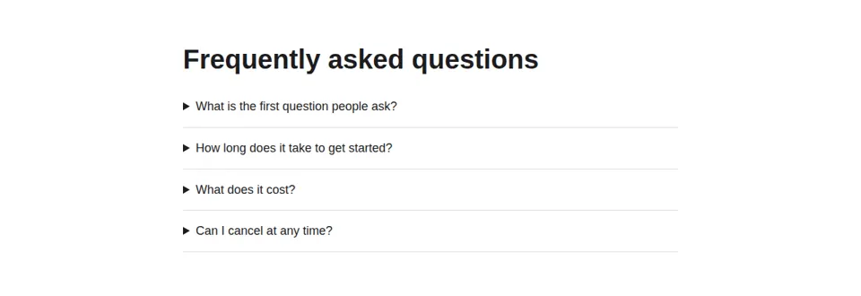 | 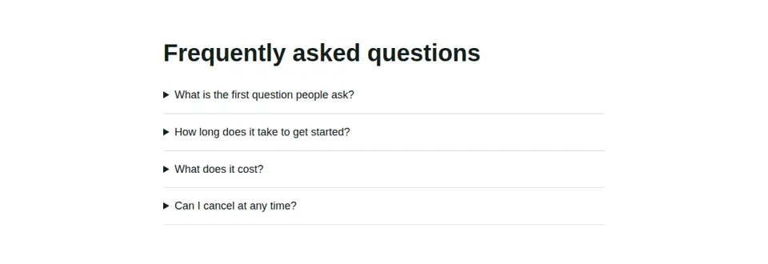 |  |

## Logo wall
`evive/logo-wall` · category `evive-proof`

A short line and a row of customer logos.

| Default | Dark primary | Mobile |
|---|---|---|
| 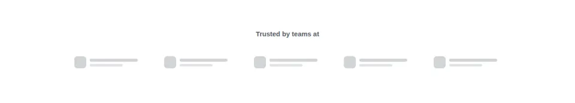 | 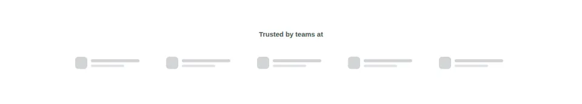 | 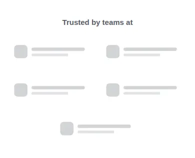 |

**Moving strip** (evive #413): select the row of logos (the inner Group) and pick the block style *Moving strip*. On the site the logos then glide slowly to the side in an endless loop (CSS only; the theme repeats the logos so the loop has no gap, the copies are hidden from screen readers and keyboard). It pauses on hover, while something in it has keyboard focus, and with the small *Pause animation* checkbox below it. With *reduce motion* switched on in the visitor's system, or with JavaScript switched off in the browser (CSS `@media (scripting: none)`), it stands still as a normal row of logos that scrolls sideways. In the editor it shows as that still row. The speed follows the number of logos (5 s per logo per round).

| Moving strip, desktop (1280) | Moving strip, mobile (390) |
|---|---|
|  |  |

## Testimonial
`evive/testimonial` · category `evive-proof`

One large customer quote with name, role and photo.

| Default | Dark primary | Mobile |
|---|---|---|
|  |  |  |

## Testimonial: large photo
`evive/testimonial-photo` · category `evive-proof`

A large photo of the person (4:5, cropped to fill) next to a big quote, with name, role and company logo. On phones the photo sits above the quote. Text uses `contrast` and `muted` on `surface`; the quote mark is `primary` (all pairs from the token contract's contrast rules).

| Default | Dark primary | Mobile |
|---|---|---|
|  |  |  |

## Testimonials: grid of three
`evive/testimonials-grid` · category `evive-proof`

Three customer quotes as cards.

| Default | Dark primary | Mobile |
|---|---|---|
| 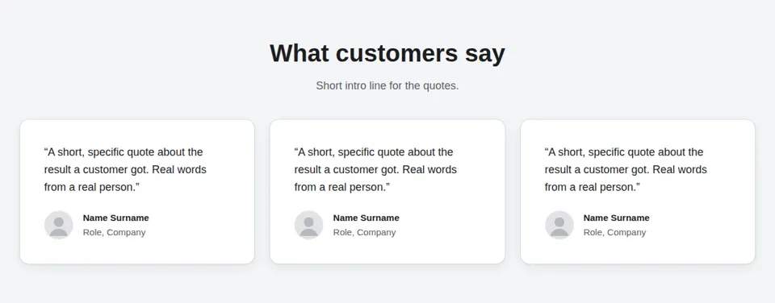 |  |  |

**Carousel** (evive #413): select the Columns block and pick the block style *Carousel*. The cards become one row that scrolls sideways and snaps to a card: about one card on phones, two on tablets and laptops, three on wide screens (1100px and up) when there are four or more columns. Add more cards by adding columns. A small script (`assets/js/carousel.js`, only loaded on pages with a carousel) shows *previous* / *next* buttons under the row, only when there is something to scroll; they are real buttons (Tab, Enter/Space) and the row itself can be focused and scrolled with the arrow keys. Without JavaScript there are no buttons and the row simply scrolls (touch, trackpad, scrollbar, arrow keys).

| Carousel, desktop (1280) | Carousel, mobile (390) |
|---|---|
| 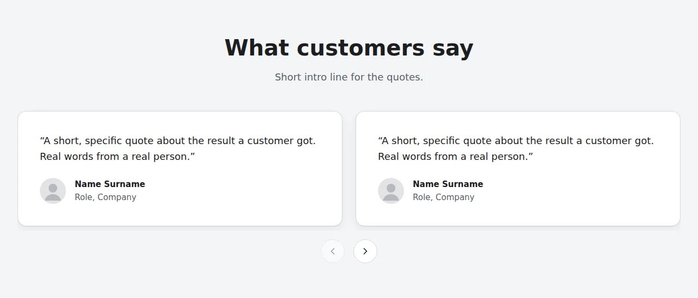 | 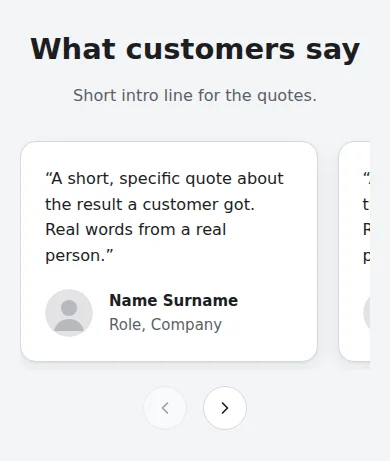 |

## Stats
`evive/stats` · category `evive-proof`

Four big numbers with a label each.

| Default | Dark primary | Mobile |
|---|---|---|
|  | 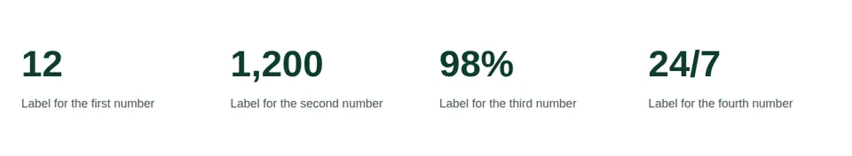 | 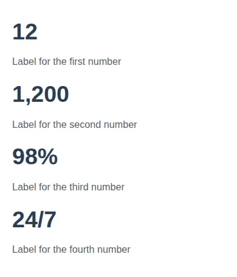 |

## Team: grid of people
`evive/team` · category `evive-content`

A grid of people: square photo with rounded corners (radius `l`), name, role and a LinkedIn link (Social Icons block, logos only, in the `muted` colour, `primary` on hover). Four per row on wide screens (the column count in the grid settings; set 3 for three per row), two per row on phones. Set each LinkedIn URL, or remove the icon for someone without one. The placeholder avatar is round itself; a real square photo shows the rounded corners.

| Default | Dark primary | Mobile |
|---|---|---|
|  |  | 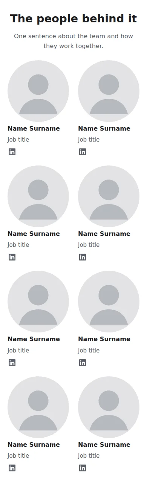 |
## Contact: text and form
`evive/contact` · category `evive-cta`

Contact or demo request section: a small label, heading, intro and contact details (email, phone, address; links where they have one) on the left, a form in a Card on the right: name and email side by side (required), company, message (required). The form is the **Form** block of the evive Forms plugin: spam trap, minimum fill time and rate limit, entries under "Form entries", mail through `wp_mail` (so through FluentSMTP where that is set up). Set the recipient in the Form block's settings or in Settings → evive Forms; add a consent field there if the site needs one. Needs evive Forms active. Stacks on phones, text first.

| Default | Dark primary | Mobile |
|---|---|---|
| 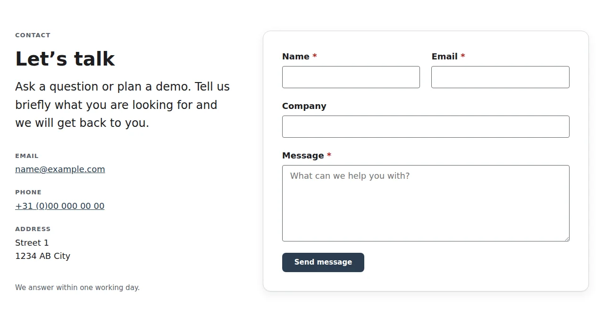 | 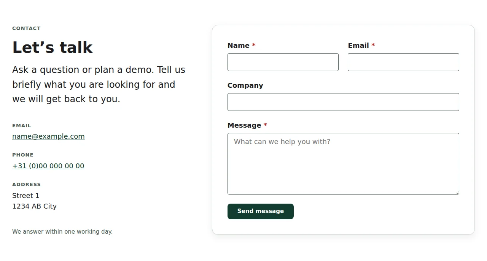 |  |
## Blog teasers
`evive/blog-teasers` · category `evive-content`

The three latest posts as cards: featured image, category, title, excerpt and date, with an "All articles" link to the posts page (or the home page when the latest posts are on the front page). The cards fill themselves from the site's posts: with one or two posts the row shows fewer cards, with none it shows "No articles yet.". Three per row on wide screens, one on phones. A post without a featured image gets a card without an image (evive #408).

Screenshots from a fresh test site with only WordPress's sample post (no featured image), so they show one card.

| Default (1280) | Mobile (390) |
|---|---|
|  |  |
## Integrations grid
`evive/integrations` · category `evive-features` (evive #409)

Section heading, a row of static category labels (pills; the one with class `is-active` is on the primary colour) and a grid of integration tiles: logo, name and one line. The labels are plain text, not a working filter: change them or delete the list. Four columns on wide screens, two on tablets, one on phones, where each tile becomes a compact row with the logo on the left. Put each integration's own square logo in place of the placeholder icon; real names (Microsoft 365, Teams, Outlook, …) go in the page, not the pattern.

| Default | Dark primary | Mobile |
|---|---|---|
| 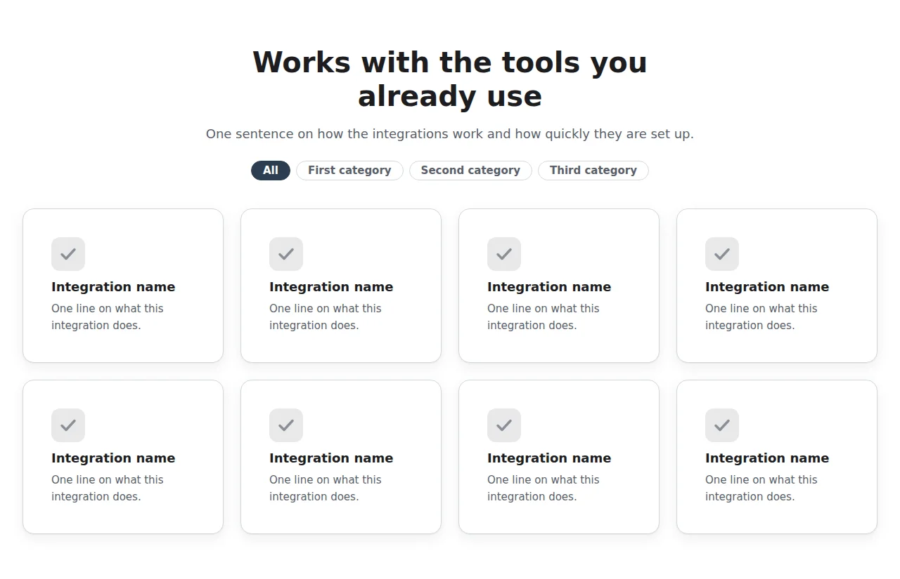 | 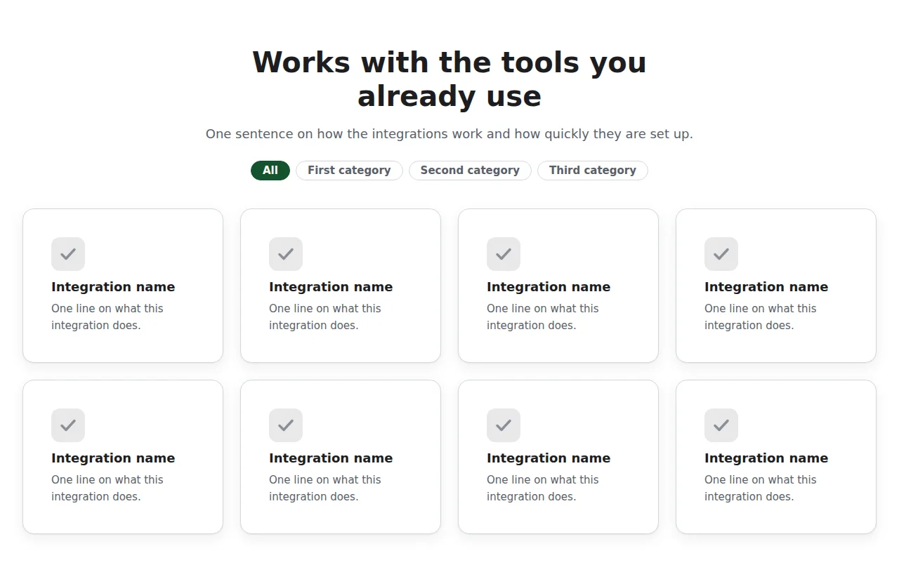 |  |

## Header and footer (0.2.0)
`evive/header` (default), `evive/header-no-cta`, `evive/header-sticky`; `evive/footer` (extended), `evive/footer-simple`. See `CHANGELOG.md`.

## Blocks: Before / after
`evive/before-after` · block category Media · `blocks/before-after/` (evive #412)

Two images with a divider for make-over cases: the left part shows the before image, the right part the after image.
- **Mouse:** drag anywhere on the picture, or click a spot. **Touch:** drag sideways or tap a spot; a vertical swipe still scrolls the page. **Keyboard and screen readers:** a range input (Tab to it; arrow keys, Page Up/Down, Home/End), labelled "Divider between before and after", with the value read as a percentage. The grip shows a focus ring.
- **Editor:** the block holds two ordinary Image blocks (locked to two), so alt text, the media library and image sizes work as usual. In the sidebar: the two labels (empty = translated "Before"/"After") and the start position of the divider. Wide and full alignment.
- **Without JavaScript** both images are shown side by side with their labels (stacked on phones). The script (`view.js`) and the styles load only on pages that use the block.
- The before image sets the size; the after image is fitted to it (`object-fit: cover`), so use two images with the same aspect ratio. A transparent after image sits on the `base` colour.

| With JavaScript (divider at 45%) | Without JavaScript |
|---|---|
|  |  |

| Mobile | Mobile, without JavaScript |
|---|---|
| 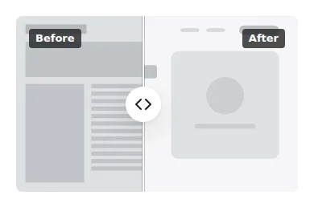 | 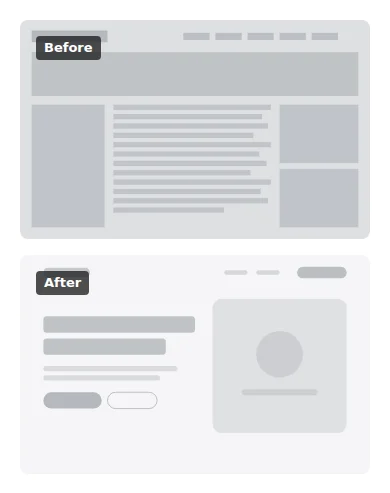 |
