# Pattern library — evive-base

Generic patterns every customer can use. They contain neutral placeholder text (translatable, text domain `evive`) and placeholder art shipped in `assets/images/`, use tokens only, and make no external requests. Customer-specific patterns live in the child theme.

**Live gallery:** https://whyatwork.cloud/pattern-gallery/ (staging; shown with the active theme, so with a child theme active it shows the customer's brand).

Screenshots per pattern: **default palette** (desktop), **dark-primary test palette** (desktop) and **mobile** (390px, default palette). The dark-primary palette is the test palette of card D.1: deep green primary with an orange accent; its values are in `tools/pattern-shots/palettes.json`. New screenshots: `tools/pattern-shots/README.md` (one command per batch).

## Building blocks used by the patterns
- **Card** block style for Group (`is-style-card`): `base` background, `border` hairline, radius `l`, shadow `s`.
- **Motif** block style for Group (`is-style-motif`): two large, faded rounded-rectangle outlines in the text colour behind the section. Used by *Hero: on primary colour*.
- **Shadow tokens** `s`, `m`, `l` (added in 0.3.0, as proposed in D.1). They are built from the `contrast` colour with `color-mix()`, so they follow the palette.
- **Page without title** template (`page-no-title`) for pages that start with a hero (the hero has the H1).
- **Moving strip** block style for Group (`is-style-logo-strip`) and **Carousel** block style for Columns (`is-style-carousel`): see *Logo wall* and *Testimonials: grid of three* below (evive #413).
- **Slides** and **Slides, autoplay** block styles for Group, **Muted loop** block style for Video, and the privacy embed for YouTube/Vimeo: see *Video and slides* below (evive #546).
- **FAQ structured data:** a Group with class `evive-faq` outputs `FAQPage` JSON-LD built from its Details blocks (summary = question, content = answer). Editors only edit the visible text.

## Block: Tabs
`evive/tabs` with inner `evive/tab` blocks · block category Design · theme block in `blocks/tabs/` (evive #411)

Content in tabs (for example desks / rooms / parking): one tab is shown at a time and each tab holds any blocks. Inserting the block gives three tabs; add more with the + below the last tab, and type each tab's label above its content. In the editor all tabs are shown one below the other.

- **Accessible:** WAI-ARIA tabs pattern: `role="tablist"`, `tab` and `tabpanel`, linked with `aria-controls` / `aria-labelledby`. Mouse, touch and keyboard: Tab moves to the selected tab, Left/Right arrows (wrapping), Home and End switch tabs; Tab again moves into the open panel. A link to an anchor inside a panel opens that tab.
- **Without JavaScript** the tab list stays hidden and every tab is shown with its label as a heading (H3), as in the last screenshot.
- **Loading:** its script (`view.js`, about 2.5 KB, not minified) and CSS load only on pages that contain the block.
- **Tokens:** labels `muted`, the selected tab `contrast` with a `primary` underline, the line below the list `border`.
- **Saved markup:** both blocks save only their inner blocks (labels in the block comment); the tab list is rendered in PHP, so later front-end changes don't make saved content invalid.

| Default | Dark primary (tab "Rooms" selected) | Mobile |
|---|---|---|
|  |  |  |

Without JavaScript:

## Hero: text and image
`evive/hero-media` · category `evive-hero`

Page heading, intro text and two buttons, with an image or screenshot on the side.

| Default | Dark primary | Mobile |
|---|---|---|
|  | 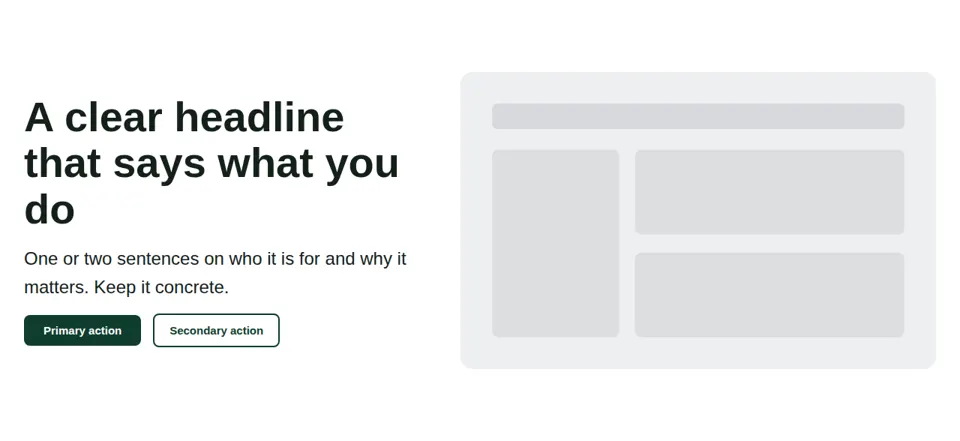 |  |

## Hero: split 50/50
`evive/hero-split` · category `evive-hero`

Two equal halves: text on a surface background, image on the other side.

| Default | Dark primary | Mobile |
|---|---|---|
|  | 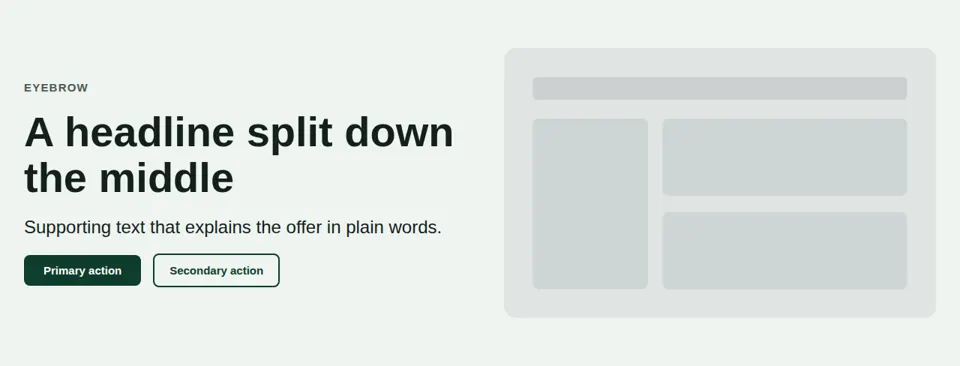 | 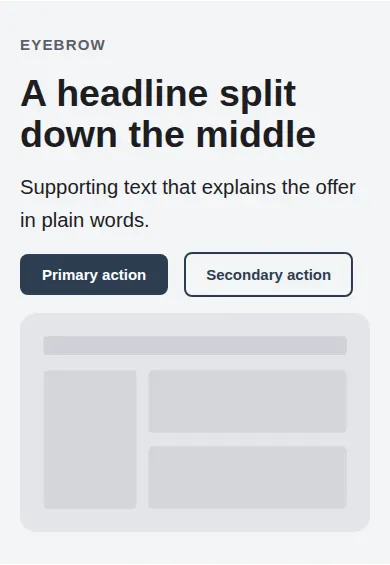 |

## Hero: page title and intro
`evive/hero-page` · category `evive-hero`

Simple page hero: heading and an intro paragraph, for inner pages.

| Default | Dark primary | Mobile |
|---|---|---|
|  |  | 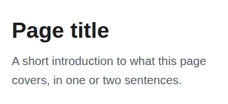 |

## Hero: on primary colour
`evive/hero-primary` · category `evive-hero`

Hero on the primary colour. Uses the Motif block style (faded rounded rectangles); switch the style to Default to remove it.

| Default | Dark primary | Mobile |
|---|---|---|
| 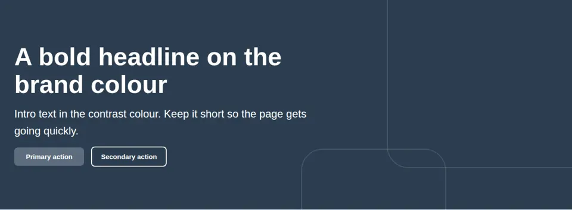 | 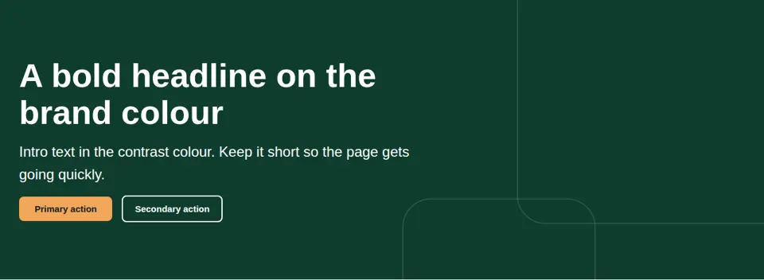 |  |

## Features: three cards
`evive/features-cards` · category `evive-features`

Section heading and three feature cards with an icon, text and a link.

| Default | Dark primary | Mobile |
|---|---|---|
|  |  |  |

## Features: alternating image and text
`evive/features-alternating` · category `evive-features`

Rows of text and image that swap sides, one per feature.

| Default | Dark primary | Mobile |
|---|---|---|
| 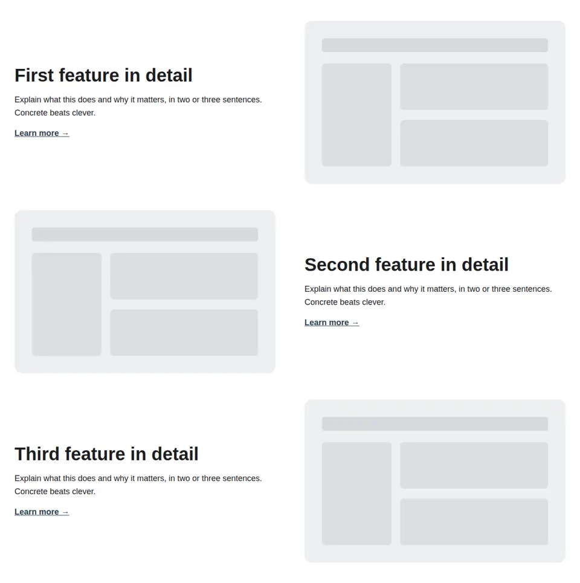 | 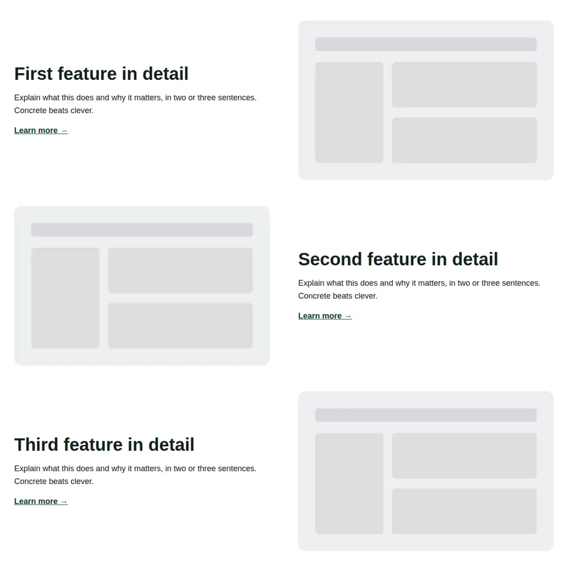 | 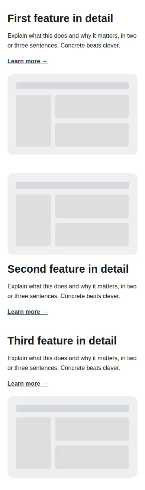 |

## Features: icon list
`evive/features-icon-list` · category `evive-features`

Heading on the left, a two-column list of short points with icons on the right.

| Default | Dark primary | Mobile |
|---|---|---|
|  | 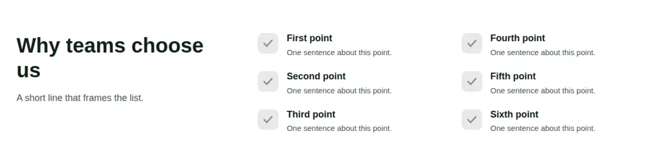 | 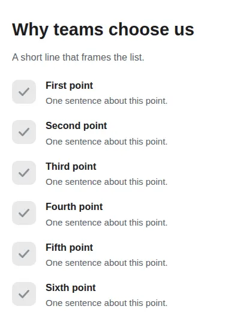 |

## CTA band: primary colour
`evive/cta-primary` · category `evive-cta`

Call-to-action band on the primary colour with one button.

| Default | Dark primary | Mobile |
|---|---|---|
| 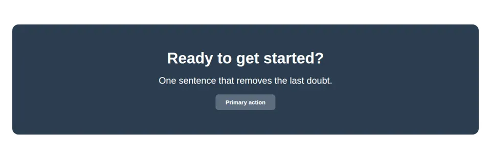 |  |  |

## CTA band: surface
`evive/cta-surface` · category `evive-cta`

Call-to-action band on the surface colour with one button.

| Default | Dark primary | Mobile |
|---|---|---|
|  | 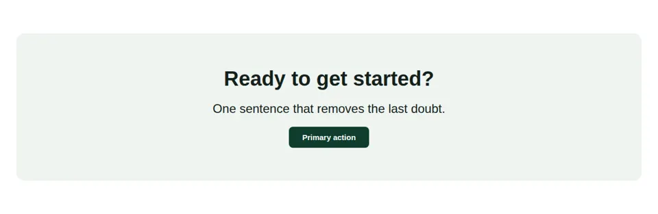 | 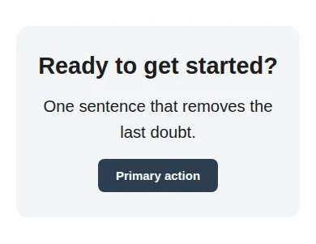 |

## FAQ
`evive/faq` · category `evive-content`

Frequently asked questions as expandable Details blocks. Adds FAQPage structured data (JSON-LD) built from the questions and answers.

| Default | Dark primary | Mobile |
|---|---|---|
|  |  | 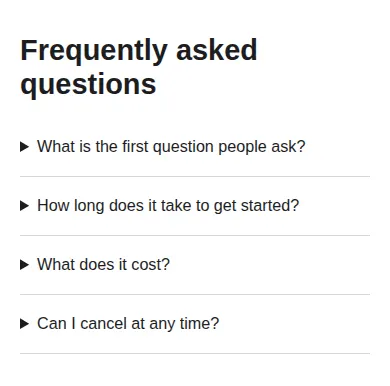 |

## Logo wall
`evive/logo-wall` · category `evive-proof`

A short line and a row of customer logos.

| Default | Dark primary | Mobile |
|---|---|---|
|  |  |  |

**Moving strip** (evive #413): select the row of logos (the inner Group) and pick the block style *Moving strip*. On the site the logos then glide slowly to the side in an endless loop (CSS only; the theme repeats the logos so the loop has no gap, the copies are hidden from screen readers and keyboard). It pauses on hover, while something in it has keyboard focus, and with the small *Pause animation* checkbox below it. With *reduce motion* switched on in the visitor's system, or with JavaScript switched off in the browser (CSS `@media (scripting: none)`), it stands still as a normal row of logos that scrolls sideways. In the editor it shows as that still row. The speed follows the number of logos (5 s per logo per round).

| Moving strip, desktop (1280) | Moving strip, mobile (390) |
|---|---|
| 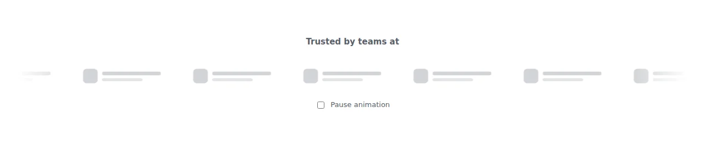 | 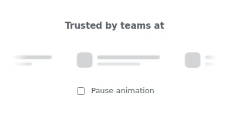 |

## Testimonial
`evive/testimonial` · category `evive-proof`

One large customer quote with name, role and photo.

| Default | Dark primary | Mobile |
|---|---|---|
| 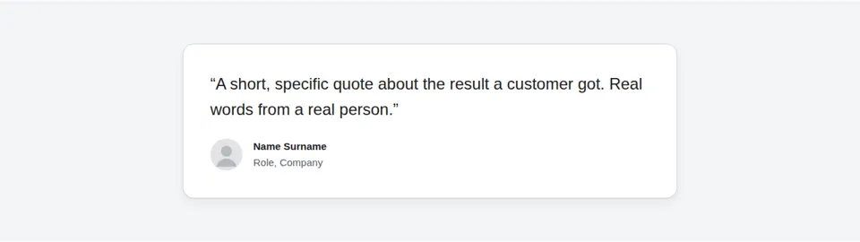 | 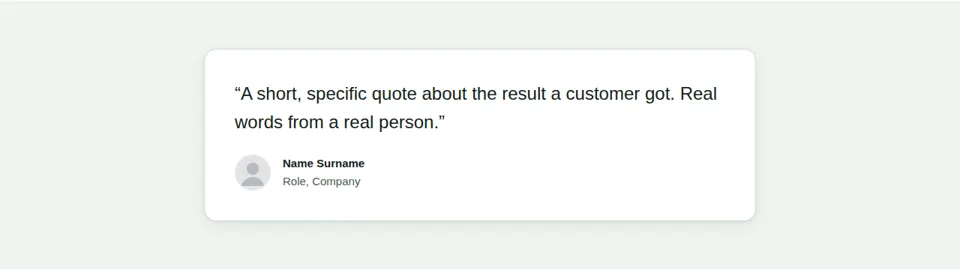 |  |

## Testimonial: large photo
`evive/testimonial-photo` · category `evive-proof`

A large photo of the person (4:5, cropped to fill) next to a big quote, with name, role and company logo. On phones the photo sits above the quote. Text uses `contrast` and `muted` on `surface`; the quote mark is `primary` (all pairs from the token contract's contrast rules).

| Default | Dark primary | Mobile |
|---|---|---|
| 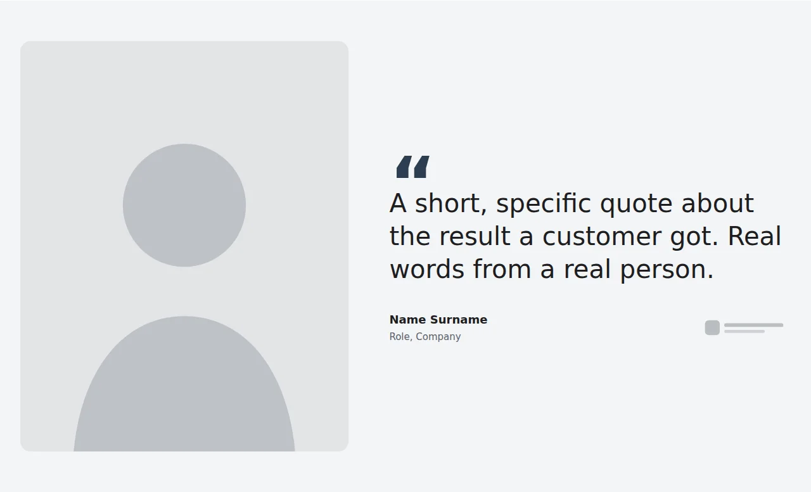 | 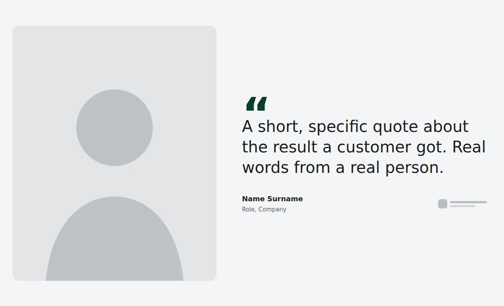 | 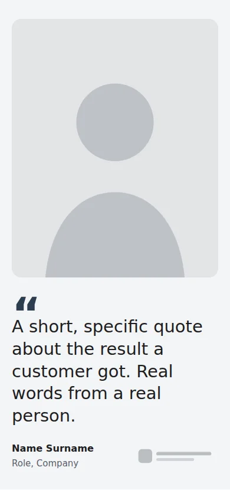 |

## Testimonials: grid of three
`evive/testimonials-grid` · category `evive-proof`

Three customer quotes as cards.

| Default | Dark primary | Mobile |
|---|---|---|
|  | 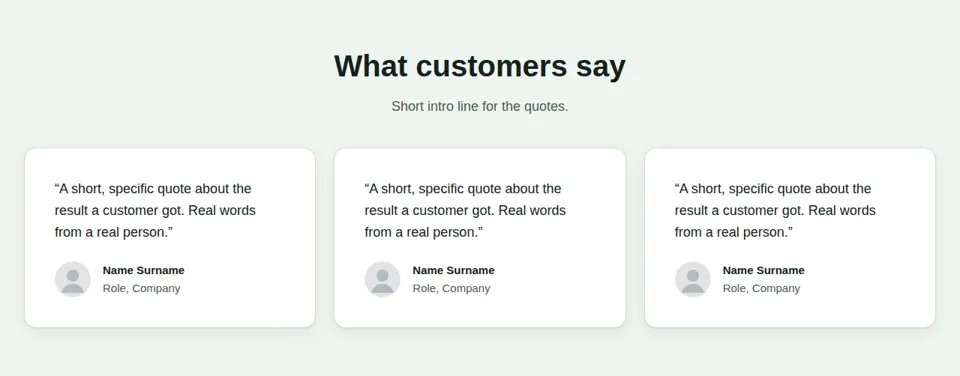 | 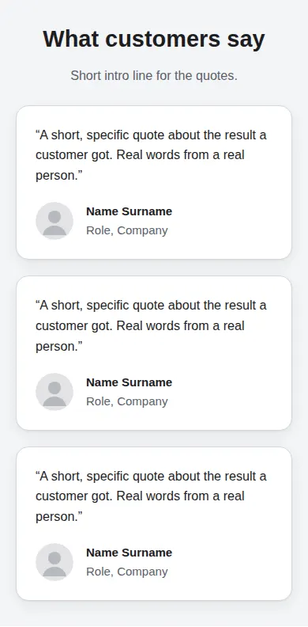 |

**Carousel** (evive #413): select the Columns block and pick the block style *Carousel*. The cards become one row that scrolls sideways and snaps to a card: about one card on phones, two on tablets and laptops, three on wide screens (1100px and up) when there are four or more columns. Add more cards by adding columns. A small script (`assets/js/carousel.js`, only loaded on pages with a carousel) shows *previous* / *next* buttons under the row, only when there is something to scroll; they are real buttons (Tab, Enter/Space) and the row itself can be focused and scrolled with the arrow keys. Without JavaScript there are no buttons and the row simply scrolls (touch, trackpad, scrollbar, arrow keys).

| Carousel, desktop (1280) | Carousel, mobile (390) |
|---|---|
|  |  |

## Stats
`evive/stats` · category `evive-proof`

Four big numbers with a label each. The numbers use the paragraph style **Count up**: they count up from 0 once when they scroll into view. The final number is in the HTML (no JavaScript or reduced motion: it simply shows); text with more than one number, like `24/7`, doesn't count. The script loads only on pages that use the style.

| Default | Dark primary | Mobile |
|---|---|---|
| 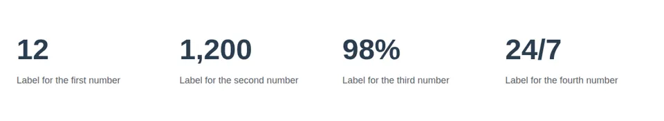 |  |  |

## Team: grid of people
`evive/team` · category `evive-content`

A grid of people: square photo with rounded corners (radius `l`), name, role and a LinkedIn link (Social Icons block, logos only, in the `muted` colour, `primary` on hover). Four per row on wide screens (the column count in the grid settings; set 3 for three per row), two per row on phones. Set each LinkedIn URL, or remove the icon for someone without one. The placeholder avatar is round itself; a real square photo shows the rounded corners.

| Default | Dark primary | Mobile |
|---|---|---|
| 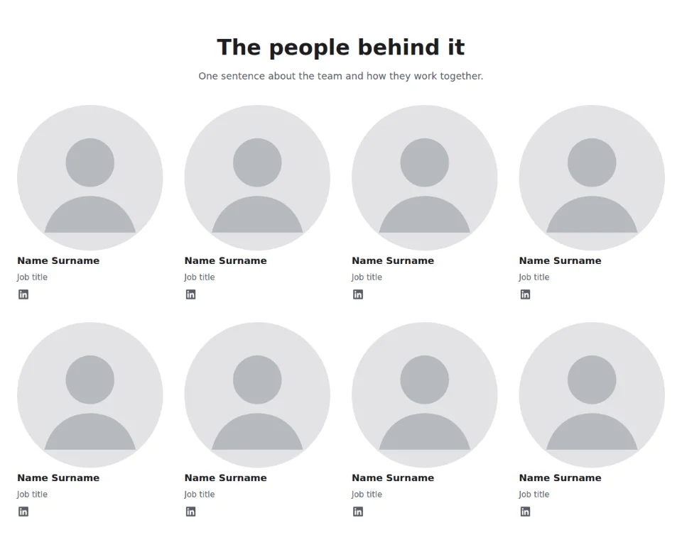 | 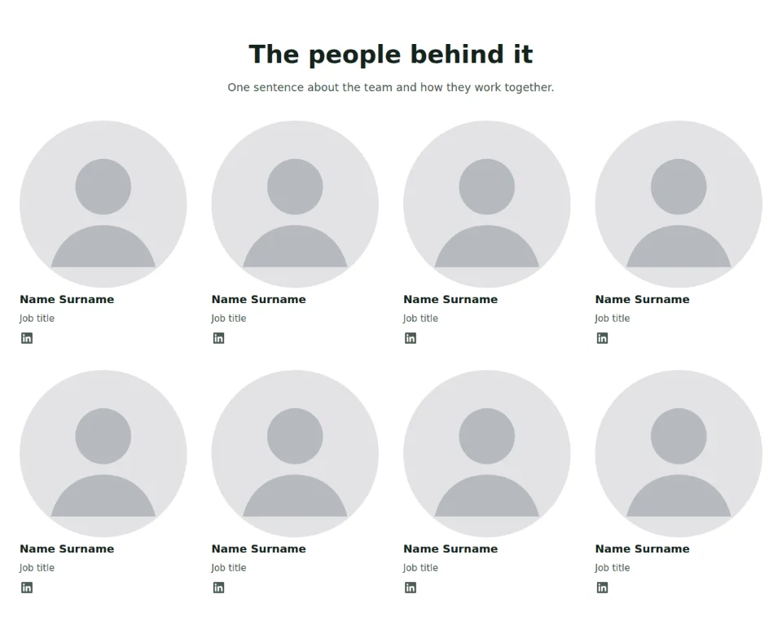 |  |
## Contact: text and form
`evive/contact` · category `evive-cta`

Contact or demo request section: a small label, heading, intro and contact details (email, phone, address; links where they have one) on the left, a form in a Card on the right: name and email side by side (required), company, message (required). The form is the **Form** block of the evive Forms plugin: spam trap, minimum fill time and rate limit, entries under "Form entries", mail through `wp_mail` (so through FluentSMTP where that is set up). Set the recipient in the Form block's settings or in Settings → evive Forms; add a consent field there if the site needs one. Needs evive Forms active. Stacks on phones, text first.

| Default | Dark primary | Mobile |
|---|---|---|
|  |  | 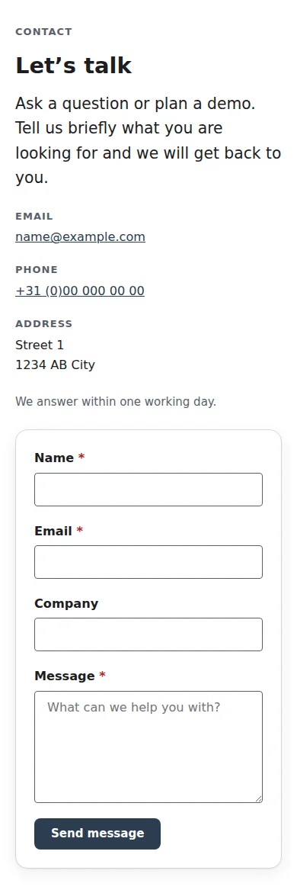 |
## Blog teasers
`evive/blog-teasers` · category `evive-content`

The three latest posts as cards: featured image, category, title, excerpt and date, with an "All articles" link to the posts page (or the home page when the latest posts are on the front page). The cards fill themselves from the site's posts: with one or two posts the row shows fewer cards, with none it shows "No articles yet.". Three per row on wide screens, one on phones. A post without a featured image gets a card without an image (evive #408).

Screenshots from a fresh test site with only WordPress's sample post (no featured image), so they show one card.

| Default (1280) | Mobile (390) |
|---|---|
| 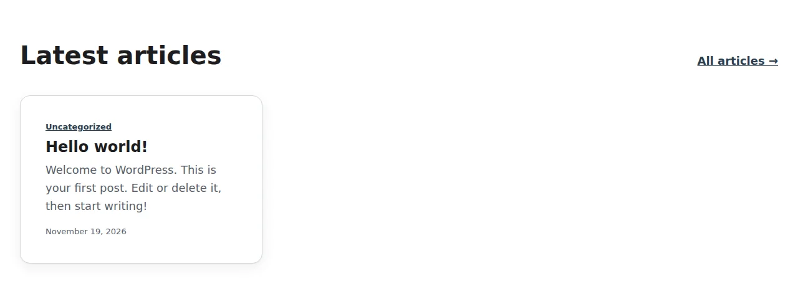 | 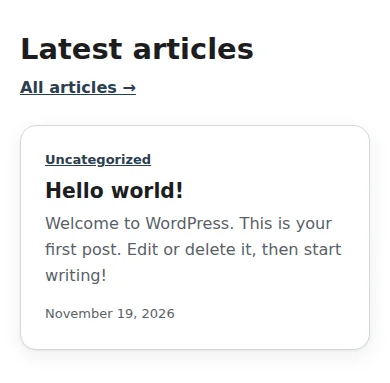 |
## Blog posts: comments and the post call to action (evive #580)
`templates/single.html`, template part `post-cta` (pattern `evive/post-cta`, not in the inserter)

- **Comments:** the Comments block on a post renders only when comments are open on that post. With comments closed there is no comments area at all (no "Comments are closed", no old comments). A site that wants a closed post's existing comments to stay visible: `add_filter( 'evive_show_comments', fn ( $show, $post_id ) => $show || get_comments_number( $post_id ) > 0, 10, 2 );`.
- **Post call to action:** after every post (below the tags, above previous/next) a card on the primary colour with a heading, one line and two buttons: "Contact us" to the page with slug `contact` (or `/contact/` when there is none) and "More articles" to the posts page. It is a template part, so it is edited in **one place**: Site Editor → Patterns → Template parts → "Post call to action"; the change shows on every post. To drop it, remove the part from the Single template. Case posts (`single-case.html`) don't have it.
- **evive builds (make-over brief):** comments off by default on a new site: Settings → Discussion → untick "Allow people to submit comments on new posts" (`wp option update default_comment_status closed`, and `wp post list --comment_status=open` / close existing ones). Fill the post call to action from the site's main conversion (demo, quote, call): heading, line, button label and link (e.g. `/contact/?type=demo`).

## Integrations grid
`evive/integrations` · category `evive-features` (evive #409)

Section heading, a row of static category labels (pills; the one with class `is-active` is on the primary colour) and a grid of integration tiles: logo, name and one line. The labels are plain text, not a working filter: change them or delete the list. Four columns on wide screens, two on tablets, one on phones, where each tile becomes a compact row with the logo on the left. Put each integration's own square logo in place of the placeholder icon; real names (Microsoft 365, Teams, Outlook, …) go in the page, not the pattern.

| Default | Dark primary | Mobile |
|---|---|---|
|  |  | 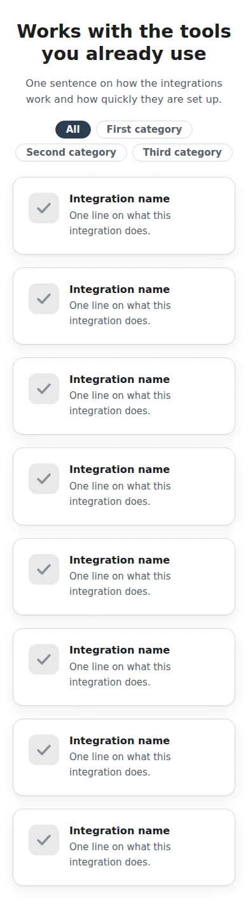 |

## Device duo: laptop with phone in front
`evive/device-duo` · category `evive-features` (evive #484)

A laptop with a desktop screenshot and a "Phone, floating" phone with an app screenshot in front of its bottom-right corner, like a classic laptop + phone mockup, but drawn in CSS: both are ordinary Image blocks with the block styles **Laptop** and **Phone, floating**, so swap in two plain screenshots (never an image with a device baked in) and set their alt text. The laptop screen has a fixed 16:10 shape and a desktop screenshot of another shape fills it from the top; the phone screen is 9:19.5 as in the Phone style. The pattern is one Group (class `evive-device-duo`) without section padding, so it can stand on its own, sit in a column next to text, or replace the image in a hero or the CTA band. Both devices are in one grid cell, so the group is as tall as the pair and nothing around it is covered. On phones the pair keeps its overlap, scaled down, with the phone a bit larger relative to the laptop. Static (no animation). Screenshots made with `tools/pattern-shots/` (pattern alone, placeholder images).

| Default | Dark primary | Mobile |
|---|---|---|
| 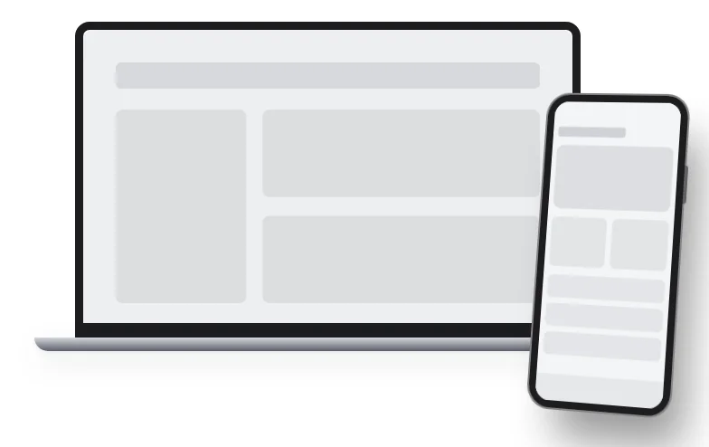 | 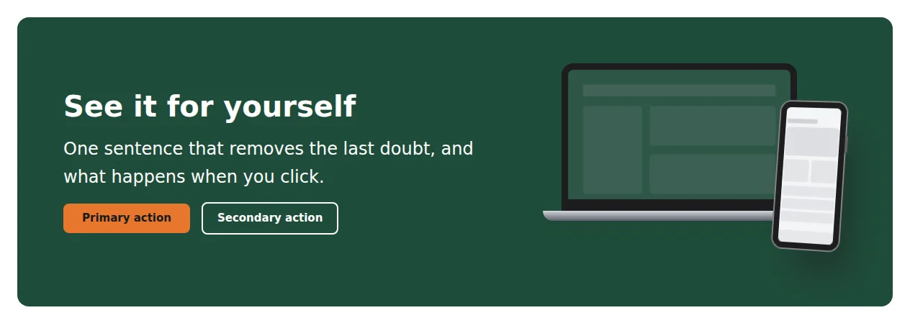 | 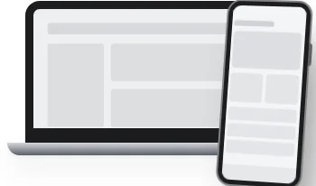 |

## Video and slides (evive #546)
Made with `tools/pattern-shots/` (evive-base alone, placeholder video and poster). The shots are taken with reduced motion, so they show the poster and the first slide.

## Hero: slider
`evive/hero-slider` · category `evive-hero` (evive #546)

Three full-width slides, each a **Cover** block (image with a dark `contrast` overlay at 80 %, text in `base`), inside a Group with the block style **Slides**. Swap in a photo per slide (Cover → replace image). Only the first slide has the page's H1, the others an H2. Add or remove slides inside the group; in the editor they stand below each other so each one can be edited.

- **Slides** (Group block style `is-style-slides`): every direct child of the group is one slide, full width, in a scroll-snap row. Under it: *previous* / *next* (wrapping around), one dot per slide (`aria-current` on the visible one, 24px targets). The row itself can be focused (Tab) and moved with Left/Right, Home and End; swipe and trackpad work as a normal scroll. The region has `aria-roledescription` "Slides", every slide is a group labelled "Slide 1 of 3". Script: `assets/js/carousel.js` (the same file as the Carousel style, only loaded on pages with slides or a carousel).
- **Slides, autoplay** (`is-style-slides-autoplay`): the same, plus a step every 6 seconds. Autoplay waits while the pointer is over the slides or the keyboard focus is in them, stops for good after a click on *previous* / *next* / a dot, and has a pause/play button (WCAG 2.2.2). With `prefers-reduced-motion: reduce` it never starts and the pause button is not shown.
- **Without JavaScript** the slides are a plain scrollable row (thin scrollbar, snapping), without buttons.
- Off by default: autoplay. Any group can use the style, e.g. for a row of image slides.

| Default | Dark primary | Mobile |
|---|---|---|
| 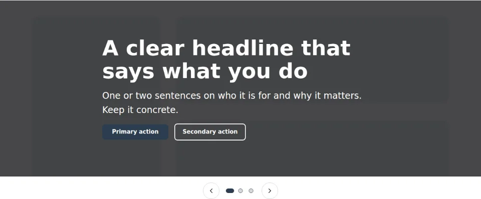 | 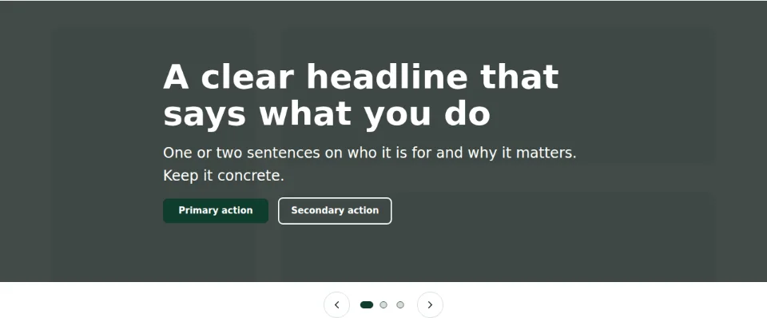 | 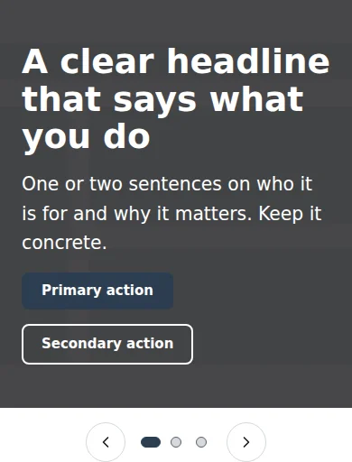 |

## Hero: text and video
`evive/hero-video` · category `evive-hero` (evive #546)

*Hero: text and image* with a short muted video that loops instead of the image: a Video block with the block style **Muted loop** (`is-style-loop`), rounded like the images (radius `l`, 16:10, the video fills the frame).

- The poster shows first. The theme renders the video with `preload="none"` and without `autoplay`, so the browser loads nothing of the video until the page has loaded; then `assets/js/video.js` starts it (muted, loop, `playsinline`).
- **Phones** (below 782px, to save data) and **reduced motion**: the video does not start by itself. The poster shows with a large play button in the middle; a tap on it (or on the video) starts it.
- A **pause/play** button in the corner is always there (WCAG 2.2.2); Tab, Enter and Space work. A click on the video also pauses it.
- **Without JavaScript** the browser's own video controls show.
- Use a short MP4 without sound (a few seconds, a few MB at most) and always set a poster image. The placeholder is `assets/video/placeholder-loop.webm` (neutral grey shapes, 6 s, 110 KB).

| Default | Dark primary | Mobile |
|---|---|---|
| 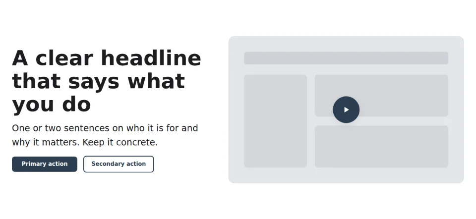 | 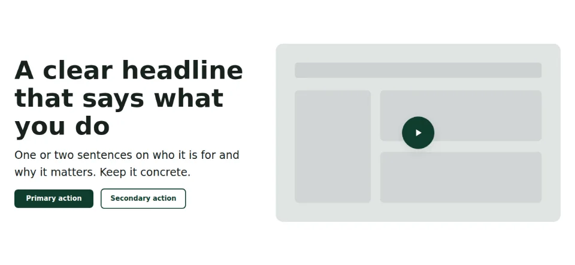 | 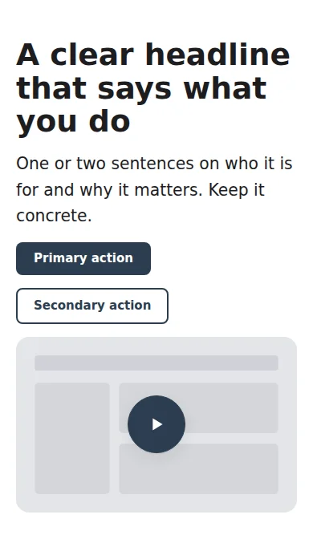 |

## Video section
`evive/video-section` · category `evive-content` (evive #546)

Heading and intro text with a video below it at content width, rounded like the images (class `evive-video` on the Video block: radius `l`, 16:10, poster fills the frame). Normal video controls and sound; `preload="none"`, so the video loads only when the visitor presses play. Replace the placeholder with your own MP4 and a poster image. For a YouTube or Vimeo video, replace the Video block with an Embed block (see *Privacy embed* below). The placeholder WebM has no stored duration, so its controls show 0:00; a real MP4 shows its length.

| Default | Dark primary | Mobile |
|---|---|---|
| 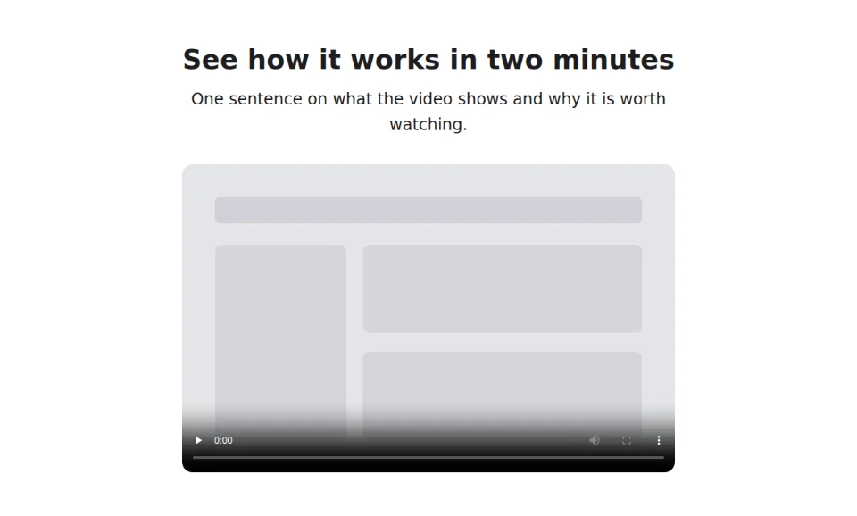 | 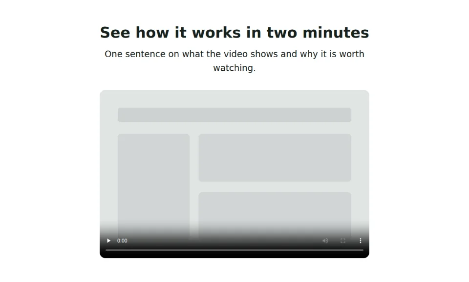 | 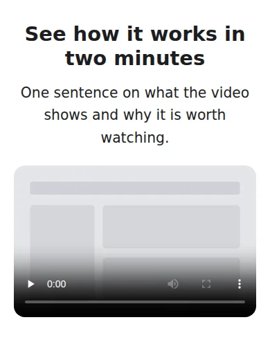 |

## Privacy embed: YouTube and Vimeo
Every core **Embed** block for YouTube or Vimeo (evive #546), no setting needed

Instead of the player the page shows the video's thumbnail, its title, a play button and one line saying where it plays from. The visitor's browser makes **no request to YouTube or Vimeo and gets no cookies** until the click: the server fetches the thumbnail once (`i.ytimg.com`, or Vimeo's oEmbed thumbnail) and stores it in `wp-content/uploads/evive-embeds/` (kept for 30 days; a failed fetch is retried after a day, and without a thumbnail the box is dark). Only the click loads the player, from **youtube-nocookie.com** or with Vimeo's **dnt=1**, and it starts playing. That makes it consent-friendly with the evive Cookie Banner: nothing to block before the click, and the click itself is the visitor's choice.

- The play button is a link to the video on YouTube/Vimeo, so **without JavaScript** it opens the video there. Keyboard: Tab to it, Enter; focus moves into the player.
- The aspect ratio of the embed (16:9 etc.) and the caption stay as they were. The editor shows the normal preview.
- Off for one embed: add the extra CSS class `evive-embed-direct`. Off for the whole site (child theme or plugin): `add_filter( 'evive_privacy_embed', '__return_false' );` (the filter also gets the block).

| Default | Dark primary | Mobile |
|---|---|---|
|  |  |  |

Thumbnail in the screenshots: *Big Buck Bunny*, © Blender Foundation, CC BY 3.0.

## Batch 2: newer patterns (screenshots evive #482)
Made with `tools/pattern-shots/` (see its README): evive-base alone on a throwaway test site, no child theme.

## Steps: how it works
`evive/steps` · category `evive-features`

“How it works” in three numbered steps: a centred heading, then per step a number in a circle, a short heading and one sentence. On wide screens a dashed line joins the steps; for four steps duplicate a column. The columns stack on phones. (evive #401)

| Default | Dark primary | Mobile |
|---|---|---|
| 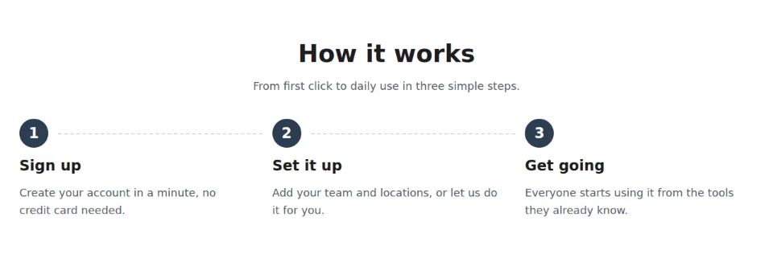 | 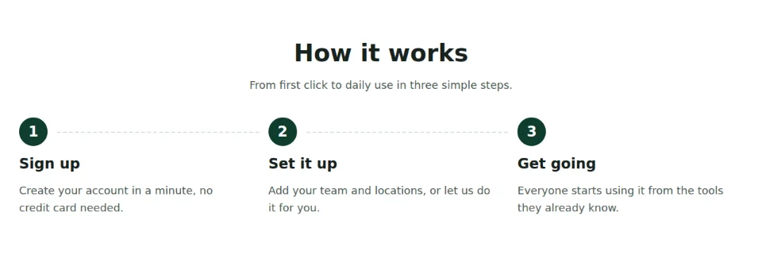 | 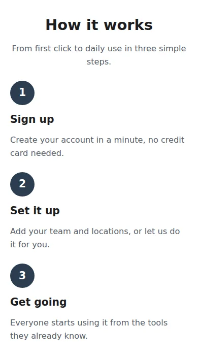 |

## Problem → solution
`evive/problem-solution` · category `evive-features`

Two cards side by side: the situation without you (cross list on the surface colour) and with you (checklist, primary border). Keep the points paired, in the same order. Stacks on phones. (evive #404)

| Default | Dark primary | Mobile |
|---|---|---|
| 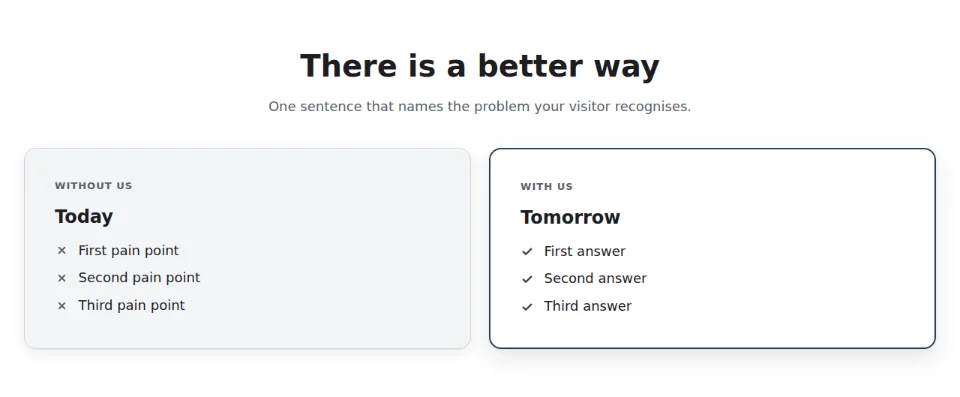 | 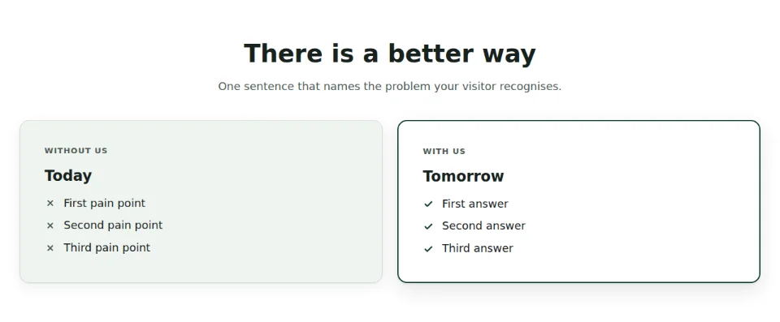 | 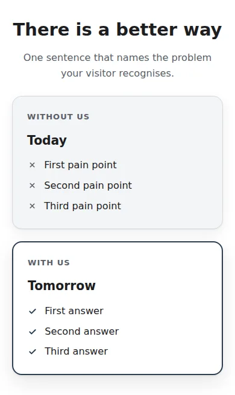 |

## Bento grid
`evive/bento` · category `evive-features`

Features as a mosaic of tiles on a four-column grid: a large tile with an image, a tile on the primary colour, a key figure, an icon tile and two wide tiles. Column and row span per tile in the block settings; keep every row filled to four columns. All tiles stack on phones. (evive #403)

| Default | Dark primary | Mobile |
|---|---|---|
| 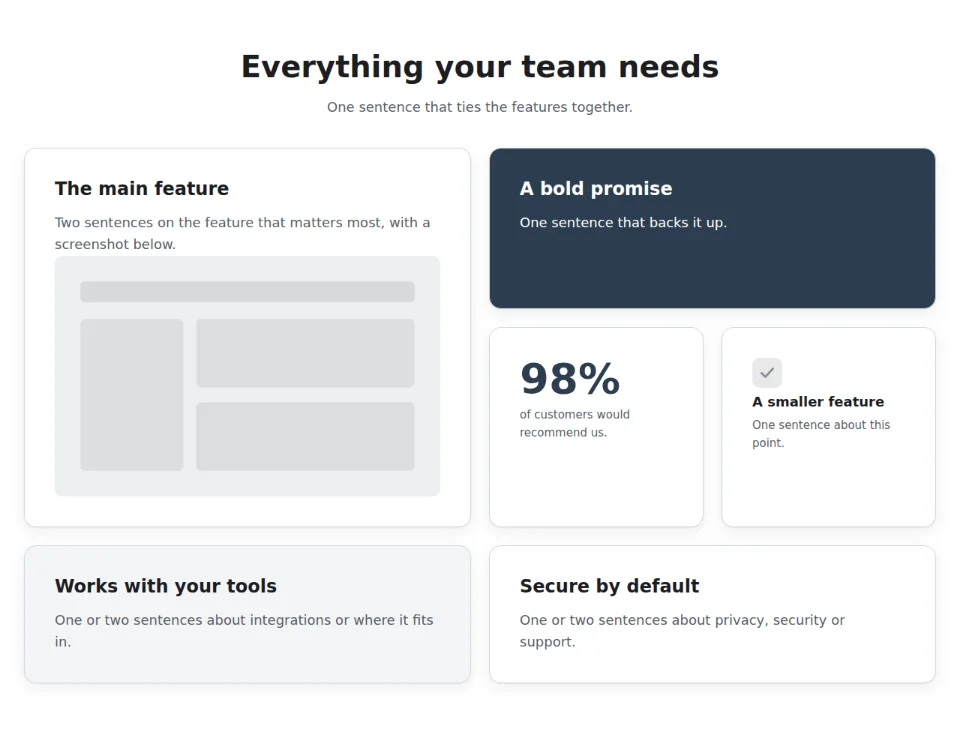 |  |  |

## Product screenshot in a device frame
`evive/product-screenshot` · category `evive-features`

Text with a checklist and a button, next to a plain screenshot in a browser-window frame. The frame is the image's block style (Browser, Phone, Laptop), so never use an image with a device baked in. (evive #402)

| Default | Dark primary | Mobile |
|---|---|---|
|  |  |  |

## Pricing: three plans
`evive/pricing-plans` · category `evive-pricing`

Three plan cards of equal height, the middle one highlighted. Centred header with name, description, price (period on its own line) and yearly price; a checklist and a button aligned at the bottom. (evive #400)

| Default | Dark primary | Mobile |
|---|---|---|
|  |  |  |

## Pricing: comparison table
`evive/pricing-comparison` · category `evive-pricing`

Feature comparison across plans: ✓ for included, an empty cell shows a dash; a row with only a bold first cell is a group heading. The header row stays visible while scrolling; on phones the table fits the screen. (evive #400)

| Default | Dark primary | Mobile |
|---|---|---|
|  |  |  |

## Pricing: add-on or single offer
`evive/pricing-addon` · category `evive-pricing`

One wide card for an add-on next to the plans: name, explanation and checklist on the left, a centred price box with a note and one button on the right. Stacks on phones. (evive #400)

| Default | Dark primary | Mobile |
|---|---|---|
|  |  |  |

## CTA band with image
`evive/cta-media` · category `evive-cta`

Call-to-action band on the primary colour with text and buttons on the left and an image on the right that sticks out above the band on desktop (made for a transparent product mockup). Real text, never text in the image. (evive #400)

| Default | Dark primary | Mobile |
|---|---|---|
|  |  |  |

## Case cards
`evive/case-cards` · category `evive-proof`

Three customer cards: logo, the result in one number, a short quote and a link to the full case post (category “Cases”). Stacks on phones. (evive #405)

| Default | Dark primary | Mobile |
|---|---|---|
|  |  |  |

## Case study
`evive/case-study` · category `evive-proof`

The body of one customer case, offered when you start a new post: key figures, challenge, solution and result, a fact box with the customer's logo, a quote and a call to action. In the category “Cases” the post gets the case layout (title, excerpt as intro, featured image). (evive #405)

| Default | Dark primary | Mobile |
|---|---|---|
|  |  |  |

## Header and footer (0.2.0)
`evive/header` (default), `evive/header-no-cta`, `evive/header-sticky`; `evive/footer` (extended), `evive/footer-simple`. See `CHANGELOG.md`.

## Blocks: Before / after
`evive/before-after` · block category Media · `blocks/before-after/` (evive #412)

Two images with a divider for make-over cases: the left part shows the before image, the right part the after image.
- **Mouse:** drag anywhere on the picture, or click a spot. **Touch:** drag sideways or tap a spot; a vertical swipe still scrolls the page. **Keyboard and screen readers:** a range input (Tab to it; arrow keys, Page Up/Down, Home/End), labelled "Divider between before and after", with the value read as a percentage. The grip shows a focus ring.
- **Editor:** the block holds two ordinary Image blocks (locked to two), so alt text, the media library and image sizes work as usual. In the sidebar: the two labels (empty = translated "Before"/"After") and the start position of the divider. Wide and full alignment.
- **Without JavaScript** both images are shown side by side with their labels (stacked on phones). The script (`view.js`) and the styles load only on pages that use the block.
- The before image sets the size; the after image is fitted to it (`object-fit: cover`), so use two images with the same aspect ratio. A transparent after image sits on the `base` colour.

| With JavaScript (divider at 45%) | Without JavaScript |
|---|---|
|  |  |

| Mobile | Mobile, without JavaScript |
|---|---|
|  |  |
